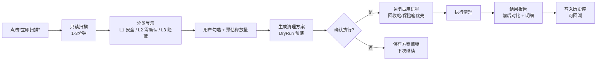
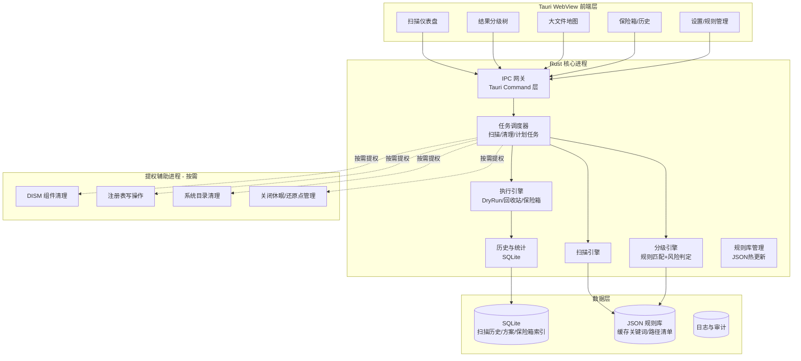

# C-Disk Cleaner 桌面端应用 · 成熟设想

> 基于开源 Skill「c-disk-cleaner」（D:\GitHub\c-disk-cleaner）的完整能力盘点，产出的 Windows 桌面端应用产品设想。
> 版本：v1.0（设想稿） ｜ 日期：2026-10-10 ｜ 状态：待评审

---

## 0. 一句话定位

**一款面向普通用户与开发者的 Windows C 盘安全清理桌面应用：先扫描诊断、按风险分级、用户自主选择、执行可追溯——把「会清理」变成「敢清理、看得见、能回滚」。**

---

## 1. 现状盘点：Skill 已有的家底

在设想产品之前，先明确这个 Skill 已经沉淀了什么、缺什么。这是所有后续设计的输入。

### 1.1 可直接继承的资产

| # | 资产 | 载体 | 成熟度 | 迁移方式 |
|---|------|------|--------|----------|
| 1 | 六大清理维度框架 | SKILL.md / README | ★★★★ | 直接映射为应用六大功能模块 |
| 2 | 三级风险分级体系（L0/L1/L2/L3） | SKILL.md / cleanup_catalog.md | ★★★★ | 完整继承，升级为可视化「风险徽标」 |
| 3 | 通用缓存识别规则（50+ 关键词、纯缓存目录、应用类型模式） | scan_c_disk.ps1 / cleanup_catalog.md | ★★★★ | 规则化 → JSON 规则库，可热更新 |
| 4 | 已安装应用感知（注册表 Uninstall 键 + 开始菜单快方式交叉匹配） | scan_c_disk.ps1 / scan_residuals.ps1 | ★★★☆ | 保留逻辑，重写为 Rust/.NET 实现 |
| 5 | 残留扫描（AppData/ProgramData/Program Files 对比 + 空文件夹分类） | scan_residuals.ps1 | ★★★☆ | 保留，增加「一键定位到已卸载项」 |
| 6 | 注册表无效项扫描（Run 键、残留键、无效计划任务，含环境变量展开与误报提示） | scan_registry.ps1 | ★★★ | 保留，UI 化 + 导出备份 `.reg` |
| 7 | WinSxS 安全清理（DISM Analyze/StartComponentCleanup，禁止 /ResetBase） | clean_winsxs.ps1 | ★★★★ | 封装为「系统深度清理」向导 |
| 8 | 清理执行器（-Targets / -TargetsFile / -DryRun / -CloseApps / -Registry，JSON 清单格式） | clean_targets.ps1 | ★★★★ | 升级为「任务执行引擎」，DryRun 保留 |
| 9 | 十条安全红线（不删个人文件、只清缓存子目录、注册表不做批量清理等） | SKILL.md / cleanup_catalog.md | ★★★★ | 固化为**不可被 UI 绕过**的代码级约束 |
| 10 | 隐私承诺（只读扫描、无遥测、无硬编码路径） | README.md | ★★★★ | 写入应用隐私条款与架构约束 |

### 1.2 Skill 形态的固有短板（应用必须补齐）

| 短板 | 现状 | 应用化后的解法 |
|------|------|----------------|
| 交互是文本流 | 输出 Format-Table，靠人眼读 | 可视化结果树、大小地图、勾选清单 |
| 误删不可回滚 | 直接 Remove-Item | 「清理保险箱」延迟删除 + 回收站优先 |
| 无历史与对比 | 每次扫描独立 | SQLite 历史库，趋势图、增量报告 |
| 权限处理粗糙 | 整脚本提权或提示手动 RunAs | 最小权限进程 + 按需 UAC 提权的独立清理进程 |
| 规则更新靠改脚本 | 关键词写死在 ps1 里 | JSON 规则库 + 内置更新通道 |
| 无人值守能力 | 必须全程人工 | 计划任务：每周自动扫描 + 用户勾选后自动执行 |
| 信任门槛 | 脚本信任成本高（看不懂的人不敢跑） | 签名安装包、清理前预览、逐项影响说明 |

---

## 2. 产品定位

### 2.1 市场定位

```
            大众清理工具                专业清理工具
        （CCleaner、360、火绒）    （Dism++、SpaceSniffer、TreeSize）
                 ↑                          ↑
                 └──────── C-Disk Cleaner ──┘
              「懂系统的安全清理」+「看得见的专业」
```

- **对大众**：像 CCleaner 一样一键上手，但**默认更保守**（可回滚、不碰注册表批量清理、无全家桶推广）。
- **对专业用户/开发者**：像 Dism++ 一样提供深度能力（WinSxS、残留、启动项、大文件地图），但**每步有解释、有影响说明**。
- **一句话差异化**：*「每一个删除决定都有依据，每一次清理都能追溯」*。

### 2.2 价值主张（对三类用户）

| 用户 | 痛点 | 本产品给的答案 |
|------|------|----------------|
| 普通用户（C 盘红了） | 不敢乱删、怕删坏 | L1 安全清理一键执行；L2 逐项讲清影响；L3 根本不出现 |
| 开发者（AppData 膨胀） | 微信/IDE/包管理器缓存几十 GB | 50+ 缓存关键词自动识别，含 npm/pip/Maven/Gradle/Rust 等包管理缓存 |
| IT 运维 / 装机人员 | 批量处理多台机器 | 便携版、命令行版、清理方案模板（profile）导出/导入 |

### 2.3 产品形态

- **主形态**：Windows 10/11 原生桌面应用（x64 / ARM64），可常驻系统托盘。
- **补充形态**：便携版（绿色免安装，面向装机/运维）；CLI 版（继承现有 PowerShell 脚本生态，供脚本调用）。
- **不支持**：macOS/Linux（本产品深度依赖 Windows 的 DISM、注册表、WMI，跨平台不划算）。

---

## 3. 核心功能设计

### 3.1 功能总览（六大维度 → 六大模块）

| 模块 | 对应 Skill 维度 | 功能内容 | 风险等级 |
|------|-----------------|----------|----------|
| A. 应用缓存清理 | 维度 1 | 通用扫描全部 AppData 目录，自动识别缓存子目录、纯缓存目录、包管理缓存 | L1 为主 |
| B. 系统临时与日志 | 维度 2 | 临时目录、WER、Minidump、更新缓存、传递优化缓存等 17 类固定路径 | L1 为主 |
| C. 系统组件存储 | 维度 3 | WinSxS：DISM 分析 → 可回收空间预估 → 安全清理向导（禁止 /ResetBase） | L1/L3 |
| D. 已卸载残留 | 维度 4 | 注册表程序清单 ↔ 目录交叉比对；空文件夹分类 | L1/L2 |
| E. 系统级大文件 | 维度 5 | 休眠文件、Windows.old、回收站、还原点；**大文件/重复文件地图** | L2 |
| F. 注册表健康 | 维度 6 | 无效启动项、已卸载残留键、无效计划任务；**逐个确认 + 导出备份** | L1/L2 |

### 3.2 核心交互闭环（继承 Skill 七步流程）



### 3.3 功能范围（1.0 全功能开源版）

> 决策：**全部功能免费开源（无 Pro 版本）**。以下功能均为目标范围，按依赖关系分两批交付。

**第一批（1.0 核心闭环）**

1. **一键智能扫描**：六大维度全量扫描，进度可视化，后台线程不卡 UI。
2. **分级结果页**：按模块分组 + 按大小排序；每项显示「路径 / 大小 / 说明 / 风险徽标 / 影响与重建方式」。
3. **L1 安全清理**：勾选或「全选 L1」，清理前 DryRun 预演，可预估释放量。
4. **清理保险箱**（差异化核心）：被删文件先移入应用内保险箱（延迟 7 天自动清除），可随时恢复——把「删错了」变成「可撤销」。
5. **占用进程感知**：检测目标路径被哪些进程占用（继承 -CloseApps 逻辑，改为列表展示 + 用户确认关闭）。
6. **清理报告**：前后空间对比、成功/失败明细、释放总量；可导出 HTML/CSV。
7. **L3 红线硬编码**：禁止项在 UI 上不出现在可勾选列表，代码层二次校验路径白名单。

**第二批（1.1+，全部免费）**

8. **计划清理**：每周自动扫描，按预设规则（如「只清 L1、总量超 5GB 才清理」）静默执行并推送报告。
9. **大文件 / 重复文件地图**：C 盘 Top 大文件、按类型/文件夹的占用热力图（继承维度 5，扩展为全局）。
10. **残留一键定位**：残留目录自动关联到注册表卸载记录，显示「卸载时间/卸载器」，确认后清理。
11. **注册表健康中心**：无效启动项、残留键的批量导出备份 + 逐项恢复日志。
12. **清理历史与趋势**：空间占用趋势图、历次清理收益统计。
13. **多用户/多盘支持**：扫描其他用户 Profile、其他磁盘（谨慎，默认只读报告）。
14. **清理方案模板**：把常用勾选组合存为模板，一键复用于多台机器（运维场景）。

### 3.4 规则引擎（Skill 规则的升级形态）

```
缓存关键词规则库 (JSON, 可热更新)
├── 通用缓存关键词（50+，继承现有列表）
├── 纯缓存目录（pip / .cache / npm-cache / pnpm / ms-playwright / .m2 / .gradle / .cargo / go-build …）
├── 应用类型模式（Chromium 浏览器 / Firefox / 通讯软件 / IDE / 包管理器 / 笔记办公 / 播放器 …）
├── 系统固定路径（17 类临时日志路径 + WinSxS + 大文件）
├── 跳过目录黑名单（Microsoft / Packages / Windows / WinSxS / Installer …）
└── 风险分级规则（缓存占比 >50% → L1；含配置 → L2；系统目录 → L3）
```

- **发布通道**：应用内置规则库版本号，云端发布新关键词，应用内「规则更新」一键拉取（仅拉取 JSON，无任何执行代码——安全边界清晰）。
- **用户自定义**：高级用户可添加自己的缓存目录规则（白名单式，标注「自定义」徽标）。

---

## 4. 技术架构

### 4.1 技术选型对比与推荐

| 方案 | 优点 | 缺点 | 适配度 |
|------|------|------|--------|
| **A. Tauri 2 (Rust 核心 + Web 前端)** | 安装包 ~10MB、内存占用低（清理工具自身不能臃肿）、Rust 递归扫描性能强、前端可用 React/TS（与开发者栈一致） | Rust 开发门槛中高；系统 API（注册表/DISM）需 FFI 或子进程 | ★★★★★ **推荐** |
| B. .NET 8 + WPF / WinUI 3 | 与 Windows API 集成最顺（注册表、WMI、进程），C# 生态成熟，Single-file 发布 | 体积 ~60-100MB、UI 打磨成本高于 Web 技术 | ★★★★ |
| C. Electron + Node | 前端技术栈最熟、生态大 | 体积 150MB+、内存占用高——对清理工具是「反讽式硬伤」 | ★★☆ |
| D. 纯 PowerShell + 控制台壳 | 最快落地（现有脚本直接复用） | 无 UI 竞争力 | ★★ |

**推荐：方案 A（Tauri 2），分两期演进引擎。**

### 4.2 分层架构



### 4.3 进程与权限模型（安全关键设计）

```
┌─────────────────────────────────────────────┐
│ 主进程（普通用户权限）                        │
│  · UI、扫描（只读）、分级、DryRun、历史        │
│  · 绝不持有写权限                             │
└──────────────┬──────────────────────────────┘
               │ IPC（仅白名单指令）
┌──────────────▼──────────────────────────────┐
│ 清理进程（按需 UAC 提权，独立 exe）            │
│  · 只接收「已验证的清理任务清单」               │
│  · 执行后立即退出，不常驻                     │
│  · 逐项校验：路径在规则白名单内、非 L3、       │
│    非用户个人目录、未越界                     │
└─────────────────────────────────────────────┘
```

要点：
1. **最小权限原则**：扫描永远不需要管理员权限；只有写操作才触发 UAC，且每次独立提权。
2. **提权进程零信任**：主进程传给提权进程的是「任务清单 + 主进程签名校验」，提权进程内部再做一次路径白名单校验（防 UI 被篡改/注入）。
3. **无常驻提权**：提权进程完成任务即退出，不驻留后台，降低被利用面。
4. **代码签名**：正式发布必须 EV 代码签名证书，提权进程单独签名，UAC 弹窗显示可信发布者。

### 4.4 数据模型（核心表）

| 表 | 关键字段 | 用途 |
|----|----------|------|
| `scan_sessions` | id, started_at, finished_at, before_free, after_free, status | 每次扫描会话 |
| `scan_items` | session_id, module, path, size_bytes, risk_level, matched_app, cache_ratio, status(待清理/已清理/跳过/失败), remark | 扫描结果明细 |
| `clean_plans` | id, name, created_at, items_json, dryrun_result, status | 清理方案（继承 JSON 清单格式） |
| `clean_logs` | plan_id, item_id, action, freed_bytes, result, error | 执行审计日志 |
| `safe_box` | id, original_path, quarantined_path, size_bytes, expire_at, restored_at | 保险箱（延迟删除） |
| `rules_meta` | version, source, updated_at, checksum | 规则库版本管理 |

> 迁移自 Skill 的 JSON 清单格式（`{Name, Path, KeepFolder, RegPath, RegName}`）自动映射为 `scan_items` + `clean_plans`，老用户方案可直接导入。

### 4.5 与现有 PowerShell 资产的关系

| 阶段 | 引擎策略 |
|------|----------|
| M1（MVP） | UI 壳（Tauri）通过白名单 IPC 调用**现有 5 个 ps1 脚本**（保留成熟逻辑，`-DryRun` 全开），解析结构化输出（脚本改为输出 JSON 流而非 Format-Table） |
| M2+ | 扫描/分级/执行逐步以 **Rust 重写**（性能：递归扫描提升 3-5 倍、无 PowerShell 进程开销）；DISM/注册表等系统 API 保留为提权子进程 |
| 长期 | 现有 ps1 保留为「CLI 兼容层」与「开源审计对照物」，核心走原生实现 |

---

## 5. 安全与信任体系（产品生命线）

> 清理工具的本质是「用户把删除权交给你」。安全不是功能，是产品成立的前提。以下规则全部继承自 Skill 并**升级为代码级约束**。

### 5.1 红线清单（继承 + 强化）

| 红线 | Skill 原规则 | 应用化强化 |
|------|--------------|------------|
| 用户个人文件 | 桌面/文档/下载/图片/视频不代删 | 个人目录出现在「只报告」分区，任何操作不可勾选 |
| 应用目录 | 只清缓存子目录 | 执行引擎强制：仅允许规则库匹配的缓存子路径进入删除清单 |
| 浏览器数据 | 只清 Cache/Code Cache | User Data、书签、密码、History 进 L3 |
| WinSxS | 只用 DISM，禁止 /ResetBase | UI 层不存在 /ResetBase 选项，提权层校验参数 |
| 注册表 | 只删明确无效项，不做批量清理 | 默认单条确认；删除前强制导出 `.reg` 备份 |
| 系统关键路径 | pagefile/swapfile/Installer/System32 不碰 | 路径黑名单在 UI 层 + 提权层双重校验 |
| 还原点 | 建议保留最新一个 | 提供「清理前自动创建还原点」开关（默认开启，可配置） |

### 5.2 三级风险 UI 化

| 等级 | UI 表现 | 交互约束 |
|------|---------|----------|
| L0 只读 | 灰色信息卡 | 无操作按钮 |
| L1 安全 | 绿色徽标 + 「可重建」说明 | 一键全选，但仍需用户点击「执行」 |
| L2 需确认 | 黄色徽标 + 影响说明 + 回滚方式 | 默认不勾选；勾选需展开确认弹窗 |
| L3 禁止 | 不展示 或 红色置灰 | 代码层拦截，无法进入清理清单 |

### 5.3 防误删四道闸

1. **保险箱**（默认）：所有清理先移入保险箱，7 天内可恢复；到期自动清除并记录。
2. **DryRun 预演**：执行前先统计「将删除的文件数/大小/路径清单」，展示给用户。
3. **双确认**：L1 一键确认 + L2 逐项确认；敏感操作（注册表、WinSxS）要求输入「确认」或再次点击。
4. **审计日志**：每次清理生成不可篡改的日志（谁/何时/删了什么/释放多少），支持导出。

### 5.4 隐私承诺（写入应用内）

- 全本地处理，无遥测、无云上传、无广告 SDK。
- 唯一网络请求：规则库 JSON 更新 + 版本检查（可完全关闭）。
- 扫描数据（应用目录名/大小）不上传；报告导出由用户自己决定存放位置。
- 开源核心 + 签名发布双轨，供安全审计。

---

## 6. 用户体验设计

### 6.1 信息架构

```
启动页（空间总览：C 盘用量环形图 / 可释放预估 / 上次清理收益）
 ├─ 立即扫描 → 扫描进度 → 结果中心
 │    ├─ 应用缓存（可勾选列表，按大小排序）
 │    ├─ 系统临时与日志
 │    ├─ 组件存储（DISM 分析入口）
 │    ├─ 已卸载残留
 │    ├─ 系统级大文件 / 大文件地图
 │    └─ 注册表健康
 ├─ 清理方案（已保存/草稿/模板）
 ├─ 保险箱（可恢复列表）
 ├─ 历史与趋势（空间趋势 / 清理收益）
 └─ 设置（规则更新 / 计划任务 / 还原点开关 / 语言 / 主题）
系统托盘：常驻图标 + 右键菜单（立即扫描 / 查看结果 / 打开保险箱 / 退出）
```

### 6.2 关键交互细节

- **扫描页**：实时进度条 + 当前扫描目录；「扫描中也可浏览历史结果」。
- **结果页**：每项默认折叠，展开显示「影响与重建方式」（如：*删除后微信会重新下载图片缩略图*）——这是与竞品的核心体验差异。
- **目标空间模式**：继承 Skill 的「目标空闲空间」能力，用户输入「我希望能腾出 20GB」，应用自动推荐组合方案并标注达成度。
- **深色/浅色主题**、中文优先（可扩展英文），字体适配高分屏。

### 6.3 面向人群的默认策略

| 用户画像 | 默认配置 |
|----------|----------|
| 小白（第一次用） | 只展示 L1，保险箱全开，还原点自动创建 |
| 常规用户 | L1 + 少量 L2（需勾选），周报提醒 |
| 开发者 | 全模块可见，规则自定义，CLI 联动 |
| 运维 | 便携版 + 方案模板 + 静默计划清理 |

---

## 7. 开源与治理（无商业化）

> 决策：**全项目开源（MIT）**，所有功能免费，暂不引入任何付费/闭源层。开源不是「妥协」，而是本产品信任策略的核心组成部分——清理工具的生命线是信任，可审计即信任。

### 7.1 开源策略

| 维度 | 决策 |
|------|------|
| 许可证 | MIT（与 Skill 一致），代码、规则库、文档全部开源 |
| 仓库组织 | 单仓库 monorepo：`app/`（Tauri 应用）+ `engine/`（Rust 核心）+ `rules/`（JSON 规则库）+ `scripts/`（PowerShell CLI 兼容层） |
| 协作模式 | GitHub Issues + PR；贡献指南、行为准则（Code of Conduct）、安全披露流程（Security Policy） |
| 规则库共建 | 缓存关键词/路径规则以 PR 方式共建，合并前必须通过「误删风险评审」（见 5.1 红线） |
| 发布物 | GitHub Releases 发布签名安装包 + 便携版 + 源码包；winget 收录 |

### 7.2 发行与合规（开源也绕不开的成本）

1. **发行渠道**：GitHub Releases（主）→ winget 收录 → 可选 Microsoft Store（免费上架，无内购）。
2. **签名**：EV 代码签名证书（消除 SmartScreen 警告）——**这是开源工具仍需承担的唯一硬性成本**。
3. **软件清单**：向微软提交应用清单（类别：系统工具），确保不触发 Defender 误报——**清理工具被杀软误报是最大的发行风险，必须提前建立白名单沟通渠道**（Microsoft Defender for Endpoint 提交、卡巴斯基/火绒等厂商白名单流程）。
4. **捐赠通道**（可选）：GitHub Sponsors / 爱发电，仅作维护成本补充，不影响任何功能。

### 7.3 社区与增长

- 与 Skill 生态联动：README 互相挂链，把现有 GitHub 用户转为应用种子用户。
- 「清理报告」支持分享（无任何水印/限制），靠口碑自然增长。
- 与装机工具/运维社区合作（便携版免费分发），扩大测试面与规则贡献者。
- 社区活动：规则库贡献榜、issue 认领、多语言翻译众包。

---

## 8. 开发路线图

| 里程碑 | 周期 | 目标 | 关键交付 |
|--------|------|------|----------|
| **M0 技术验证** | 2 周 | 证明 Tauri 能调起 ps1 并解析 JSON 输出；提权子进程模型跑通 | 概念验证 Demo（命令行扫描 → 界面展示） |
| **M1 Alpha（1.0 核心闭环）** | 8-10 周 | 六大模块扫描 + L1 清理 + 保险箱 + 报告闭环 | 1.0 Alpha，内测 50 人 |
| **M2 Beta** | 6 周 | 稳定性、权限模型加固、规则库热更新、签名 | Beta 公测 500 人，启动杀软白名单流程 |
| **M3 1.0 正式版** | 4 周 | GitHub Releases 发行 + winget 收录 + 规则库共建开启 | 1.0 GA |
| **M4 1.1 全功能版** | 8 周 | 计划清理、大文件地图、注册表健康中心、方案模板 | 3.3 全部功能落地 |
| **M5 社区化长期** | 持续 | 引擎 Rust 化、规则库社区共建、多语言、CI 自动化发版 | 活跃社区与可持续维护 |

**团队假设**：核心 2-3 人（1 Rust/系统工程师 + 1 前端 + 1 产品/测试兼职）；若 M0 验证 Tauri 风险高，Plan B 切 .NET 8 WPF（多花 1-2 周 UI 成本，但系统 API 更顺）。

---

## 9. 风险与应对

| 风险 | 等级 | 应对 |
|------|------|------|
| 杀软误报导致安装失败 | 高 | 尽早走 Defender 白名单流程；签名 + 开源 + 发布「安全说明页」 |
| 误删投诉毁口碑 | 高 | 保险箱默认开启、还原点自动创建、L3 代码级拦截、审计日志 |
| 扫描性能差（AppData 递归慢） | 中 | Rust 化扫描；增量扫描（仅扫变更目录）；后台优先级限制 |
| 规则库误判（把配置当缓存） | 中 | 分级引擎默认保守；用户自定义规则需双重确认；社区反馈闭环 |
| 微软策略变化（DISM/存储感知升级） | 中 | 模块化封装系统 API，跟随系统能力迭代 |
| 开源可持续性（维护精力/动力） | 中 | 社区治理机制、贡献指南、CI 自动化降低维护成本；捐赠通道作补充 |
| 被「一键清理全家桶」污名化 | 中 | 产品叙事锚定「安全 + 可追溯」，拒绝广告/推广捆绑 |

---

## 10. 从当前仓库到产品：第一步行动清单

1. **脚本改造（先行，可立即做）**：给 5 个 ps1 增加 `-JsonOut` 参数，输出结构化 JSON（模块/路径/大小/等级/说明），替代 Format-Table——这是 UI 化的前提。
2. **规则库外置**：把 `$cacheKeywords`、系统路径清单、分级阈值从脚本抽到 `rules/cache_rules.json`，脚本与应用共用同一规则源。
3. **M0 验证**：Tauri 2 空壳 + 调用 `scan_c_disk.ps1 -JsonOut`，跑通「扫描 → 前端渲染结果树」最小链路。
4. **定义保险箱方案**：确定保险箱目录位置（建议 `%LOCALAPPDATA%\CDiskCleaner\SafeBox`）、7 天策略、跨盘移动逻辑。
5. **安全评审**：以 5.1 红线清单为 checklist，评审执行引擎的每一条路径校验。

---

## 附录 A：继承的规则库要点（供开发实现直接引用）

- **缓存关键词**：Cache/Caches/Code Cache/GPUCache/ShaderCache/GrShaderCache/Temp/Tmp/Logs/Update/CrashDumps/Crashpad/CachedData/Service Worker/blob_storage/IndexedDB/Local Storage/Network/CacheStorage/pnpm-cache/npm-cache/pip/.cache/ms-playwright/LunaCacheV2/XPlugin/radium/packages/wmpf_Applet/profile_explorer/sdk_storage/PC_Gadget/component_crx_cache/extensions/cookies/History/Top Sites/Favicons/Web Data/Login Data 等 50+ 项。
- **纯缓存目录**：pip、.cache、npm-cache、pnpm-cache、ms-playwright、.nuget\packages、.m2\repository、.gradle\caches、.cargo\registry、go-build、.codex\.tmp。
- **系统固定路径**：%TEMP%、C:\Windows\Temp、C:\Windows\Logs、C:\Windows\Logs\CBS、C:\Windows\Panther、C:\Windows\Prefetch、WER\ReportArchive|ReportQueue|Temp、C:\Windows\Minidump、MEMORY.DMP、LiveKernelReports、%LOCALAPPDATA%\CrashDumps、SoftwareDistribution\Download（L1）/ DataStore（L2）、DeliveryOptimization\Cache、C:\Windows\Debug。
- **大文件**：hiberfil.sys（L2，powercfg 开关）、pagefile.sys（L3）、swapfile.sys（L3）、Windows.old（L2）、Windows\Installer（L3）、$Recycle.Bin（L2）、还原点（L2，保留最新）。
- **注册表**：Run 键四位置（HKLM64/HKLM32/HKCU/RunOnce）；残留键（HKCU/HKLM/WOW6432Node/Classes）；判断标准=指向文件不存在 + 已确认卸载；删除前 `reg export` 备份。
- **分级规则**：缓存占比 >50% → L1；纯缓存目录 → L1；含用户配置/数据库 → L2；系统目录 → L3。

## 附录 B：与 Skill 的映射关系（验收口径）

> 应用交付后，可用此表逐项验收「Skill 能力是否 100% 落地」：6 维度全覆盖、L0-L3 分级、DryRun、CloseApps、JSON 清单兼容、DISM 安全清理、注册表备份、十条红线——任何一项缺失即视为产品未达标。
