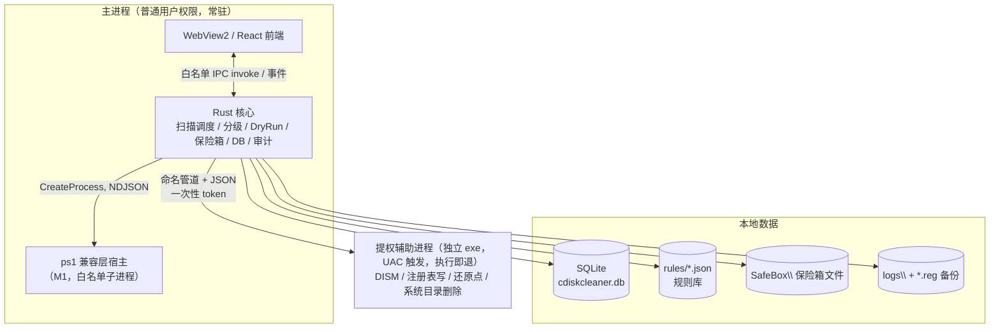
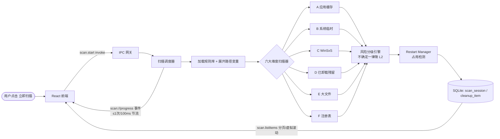
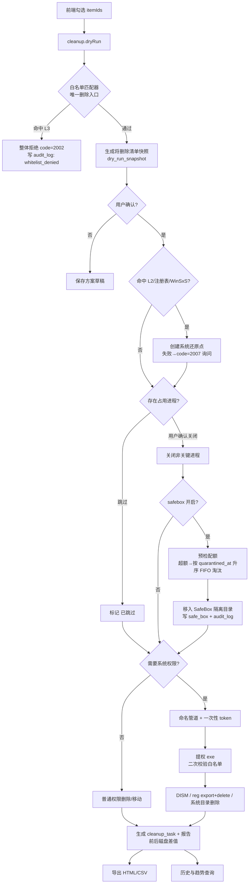
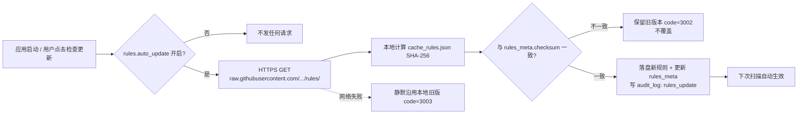
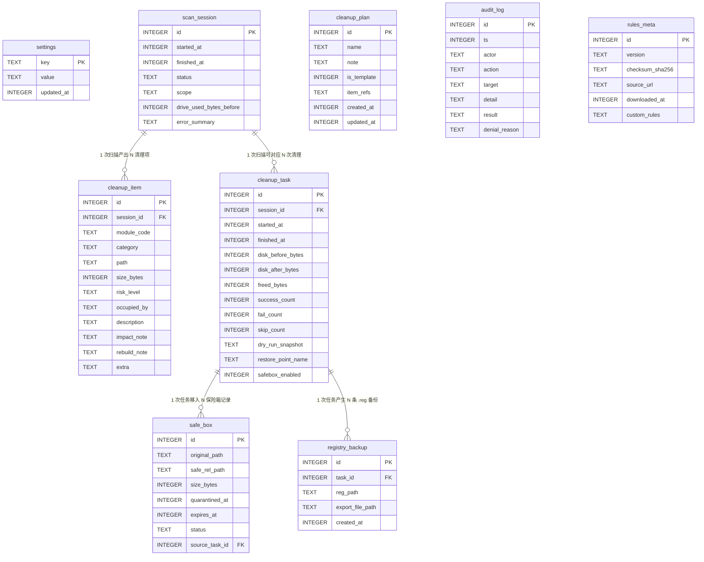
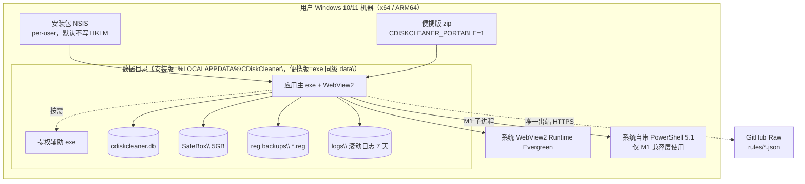
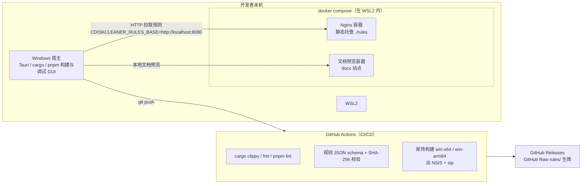
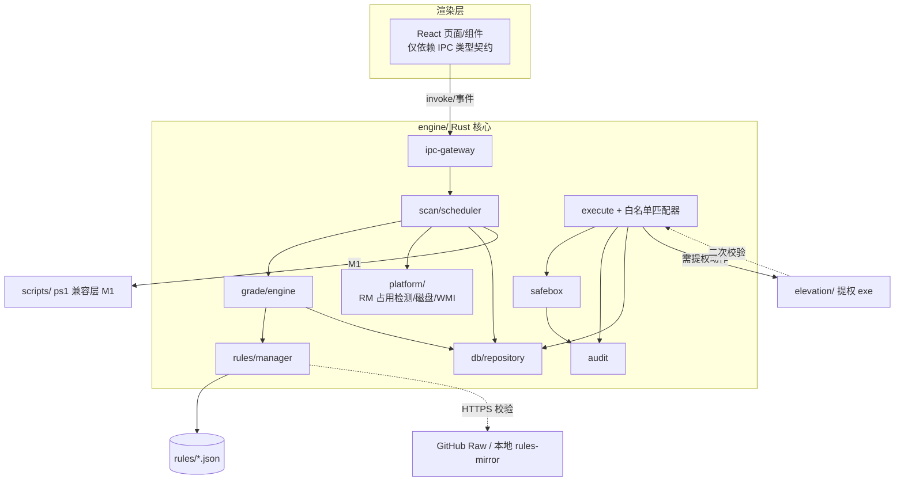

# ARCHITECTURE.md 系统架构文档

> 版本：v0.1 ｜ 日期：2026-10-11 ｜ 状态：基线版
> 上游文档：`docs/PRD.md`（产品需求）、`docs/TRD.md`（技术需求）、`docs/01-立项决策记录.md`（8 项已固化决策）
> 本文档为长期架构基线，定义系统整体架构、模块划分、数据流、数据模型、部署与安全方案；不重复业务细节，不编写业务代码。
> 任何与本文冲突的实现，以"已基线的 PRD/TRD/立项决策"为最高优先级并回写本文。

---

## 0. 阅读须知：本项目不是 Web/云应用

任务模板默认的"WSL/Docker/Nginx 反向代理/PostgreSQL"是 Web 服务端范式，但本项目经 `PRD §3.2`、`TRD §1.2/§3.3`、`决策 #6` 已固化为：

> **Windows 原生桌面应用（Tauri 2），全本地处理，无自建服务端、无账号体系、无 HTTP 后端；唯一出站网络为规则库 JSON（GitHub Raw，可关闭）。**

因此本文档对模板的适配原则为：

| 模板概念 | 本项目真实落点 |
|----------|----------------|
| 运行时 Nginx 反向代理 | **不存在于用户运行时**。仅在研发侧用 Nginx 静态托管 `rules/`，作为 GitHub Raw 的本地镜像供离线联调（见 §5.3） |
| Docker 运行时（容器跑应用） | **不存在**。Tauri 是 Win32/WebView2 桌面程序，无法、也不应跑在容器里。Docker 仅用于 CI/构建与本地规则镜像（见 §5.3） |
| 数据库服务 PostgreSQL | **替换为本地 SQLite 单文件**（rusqlite bundled，随数据目录分发，TRD §1.2） |
| WSL | **开发机环境**（开发者本机 WSL2），不是运行时依赖 |
| OWASP Top10 | 映射到桌面应用真实攻击面：IPC 边界、提权管道、规则库供应链、本地数据完整性（见 §6） |

> 一句话：**用户侧是 Windows 原生安装包，研发/CI 侧才出现 WSL + Docker Compose + Nginx。**

---

## 1. 架构概述

### 1.1 架构风格

采用 **"瘦 UI + 厚本地核心 + 按需提权子进程"的分层桌面架构**， monorepo 单仓库组织：

- **渲染层（UI）**：Tauri 2 承载的 WebView2 + React 18 + TypeScript。**渲染进程不直接触碰文件系统/注册表/磁盘**，一切能力经白名单 IPC 下发。
- **核心层（Rust 主进程，普通用户权限常驻）**：扫描调度、风险分级、DryRun、保险箱、审计、SQLite、规则库管理、IPC 网关。**主进程永不持有管理员令牌。**
- **特权层（独立提权 exe，短生命周期）**：仅当写操作命中系统目录/注册表/WinSxS/还原点时，经 UAC 触发；执行完即退出，无常驻提权。
- **兼容层（M1，PowerShell 脚本）**：主进程以子进程方式白名单调用 5 个 ps1，脚本只输出 NDJSON 流、不做交互、不联网；M2+ 逐步被 Rust 重写。
- **数据层**：本地 SQLite 单文件 + JSON 规则库 + 本地日志，全部落在用户数据目录。

### 1.2 进程模型（安全关键）



**三条硬边界**（TRD §1.3）：
1. 主进程永远普通权限运行；扫描全程零提权。
2. 提权进程只接受「动作枚举 + 已过白名单的路径列表 + 一次性 token」，不接受任意命令字符串；启动即二次校验、执行即退出。
3. 两进程间走**命名管道 + JSON 单行消息**，stdout/stderr 被主进程结构化捕获。

### 1.3 关键架构决策（与上游对齐）

| 决策 | 内容 | 来源 |
|------|------|------|
| 技术栈 | Tauri 2 + Rust + React，无 Plan B；两期演进引擎 | 决策 #1 |
| 存储 | SQLite 单文件，不依赖外部 DB 服务 | TRD §1.2 |
| 规则库 | 纯 JSON，GitHub Raw 托管，SHA-256 校验，不加签名，永不执行远端代码 | 决策 #4、TRD §4.10 |
| 平台 | 仅 Windows 10 1809+ / 11，x64 + ARM64，无跨平台抽象层 | 决策 #6 |
| 切分 | 按业务模块 A~F 切分 Agent，公共能力先行沉淀 | 决策 #7 |
| 签名 | 不买 EV 证书，接受 SmartScreen 首启警告，但必走杀软白名单 | 决策 #5 |

---

## 2. 系统模块划分

### 2.1 Monorepo 目录划分（M1 落地结构）

```
C-clean/
├── app/                  # Tauri 应用（前端 React + src-tauri 壳）
│   ├── src/              #   React/TS 渲染层（页面、状态、虚拟滚动）
│   └── src-tauri/        #   Tauri 主进程壳、窗口/托盘/IPC 注册
├── engine/               # Rust 核心库（被 src-tauri 链接）
│   ├── scan/             #   扫描调度器、目录遍历(jwalk)、进度节流
│   ├── grade/            #   风险分级引擎（L0/L1/L2；不确定即降 L2）
│   ├── execute/          #   执行引擎（删除唯一入口 delete::execute + 白名单匹配器）
│   ├── safebox/          #   保险箱：隔离移入、FIFO 淘汰、恢复、到期清除
│   ├── audit/            #   审计日志（先写后执行）
│   ├── rules/            #   规则库加载、环境变量白名单展开、SHA-256 校验、更新
│   ├── db/               #   SQLite schema、迁移、仓储
│   └── platform/         #   Restart Manager 占用检测、磁盘计量、WMI/CIM 封装
├── elevation/            # 独立提权 exe（短生命周期，命名管道服务端）
├── rules/                # cache_rules.json / rules_meta.json（与 scripts 共用同源）
├── scripts/              # M1 PowerShell 兼容层（NDJSON 输出）
└── docs/                 # 长期文档（本文档所在）
```

### 2.2 业务模块（A~F，按决策 #7 切分，端到端独立可分派）

| 模块 | 职责 | 检测输入 | 分级来源 | 执行路径 |
|------|------|----------|----------|----------|
| **A 应用缓存** | 通用缓存/包管理器缓存扫描（npm/pip/Maven/Gradle/Rust…） | 规则库路径展开 + jwalk 大小统计 | 规则条目 `risk_level` | 移入保险箱（普通权限） |
| **B 系统临时与日志** | 17 类系统固定路径、WER、Minidump、更新缓存 | 固定路径表 + WMI | 固定 L1/L2 映射 | 主进程先试普通权限，拒绝后走提权进程 |
| **C 组件存储 WinSxS** | DISM 分析与安全清理向导 | `Dism /AnalyzeComponentStore` 输出解析 | 固定 L2 | 提权进程 `/StartComponentCleanup`；**`/ResetBase` 字符串在代码库中不存在** |
| **D 已卸载残留** | 注册表卸载列表 ↔ 文件系统交叉比对 | Uninstall 键 + 目录枚举 | 空目录=L1；含配置=L2 | 移入保险箱 |
| **E 系统级大文件** | hiberfil/pagefile 计量(只读)、Windows.old、回收站、Top100 大文件地图 | 大文件流式枚举 + 回收站 API | 个人目录内=L0；休眠/Windows.old=L2 | 回收站清空/Windows.old 删除走提权；**大文件地图无删除入口** |
| **F 注册表健康** | Run 键、残留键、无效计划任务 | winreg 扫描 + 指向文件存在性校验 | 固定 L2 | 提权进程：`reg export` → 校验备份存在 → 再删；备份失败即终止该条 |

### 2.3 公共横切能力（M0/M1 主 Agent 先建，供 A~F 复用）

| 公共能力 | 说明 |
|----------|------|
| IPC 网关 | Tauri Command 层，统一响应信封 `{code,message,data}`；长任务一律 invoke + 事件订阅 |
| 白名单匹配器 | 删除动作唯一入口 `engine::delete::execute()`；所有来源（ps1 返回、CLI、UI）必须过同一函数；L3 命中返回 code=2002 |
| DryRun | `cleanup.dryRun` 与 `cleanup.execute` 基于同一 itemIds 快照；execute 内部重跑白名单，不一致即中止 |
| 保险箱 | 默认开启，5GB 配额，FIFO 淘汰，7 天到期；执行前预检配额 |
| 审计 | 任何写动作先写 `audit_log` 再执行，失败也留痕；L3 拒绝必填 `denial_reason` |
| 占用检测 | Restart Manager 批量扫描，回填 `occupied_by`；explorer/svchost 等关键进程名黑名单不提供"关闭" |
| 还原点 | 命中 L2/注册表/WinSxS 且开关开启时前置创建；失败回传 code=2007 |
| 崩溃恢复 | 启动时将 `status='running'` 的 task 标记 interrupted 并提示；保险箱文件不受影响 |

### 2.4 解耦原则（便于分 Agent 独立开发）

- 业务模块只实现「**检测 → 分级 → 执行**」三段，不各自实现调度/DB/保险箱/审计。
- 模块间通过 `scan_session` + `cleanup_item` 两张表与统一事件解耦，A~F 互不直接调用。
- 规则数据全部外置 `rules/*.json`，引擎零硬编码路径，业务 Agent 改规则不改核心代码。
- 每个模块对外暴露固定输出契约（`module_code` + `category` + item 字段），UI 与引擎按契约并行开发。

---

## 3. 数据流图（Mermaid）

### 3.1 扫描数据流（只读、零提权）



### 3.2 清理执行数据流（DryRun → 保险箱 → 按需提权）



### 3.3 规则库更新数据流（唯一出站网络）



---

## 4. 数据库 ER 图（Mermaid）

> 本地 SQLite 单文件 `<数据根>\data\cdiskcleaner.db`，UTF-8，开启外键约束；时间字段统一为 Unix 毫秒（INTEGER）。字段明细以 TRD §4 数据字典为准，下图表达实体与关系。



**关系与约束要点**：
- `cleanup_item.session_id` → `scan_session.id`，`ON DELETE CASCADE`（取消/失败的扫描连带清项）。
- `safe_box.source_task_id` → `cleanup_task.id`；FIFO 淘汰排序键为 `quarantined_at`，`expires_at = quarantined_at + 7*86400*1000`。
- `registry_backup.task_id` → `cleanup_task.id`，`ON DELETE SET NULL`（任务记录删除后备份文件仍可被历史页引用）。
- `cleanup_plan` 不绑定 `session_id`（`item_refs` 存 `{module_code, category, path}` 三元组），保证模板跨扫描复用。
- `audit_log` 为自由日志表，不建强外键；`rules_meta` 为单行表（`CHECK(id=1)`）。
- **L3 记录永不写入 `cleanup_item`**——L3 仅存在于白名单匹配器内部，命中即拒绝。

---

## 5. 部署架构（WSL + Docker Compose）

> **边界重申**（见 §0）：终端用户运行时是 Windows 原生程序，**没有容器、没有 Nginx、没有 DB 服务**。WSL + Docker Compose + Nginx 的真实角色是**开发联调与 CI 侧基础设施**。本节按"用户运行时 → 研发/CI 基础设施"两层描述。

### 5.1 终端用户运行时部署（Windows 原生，真正交付物）



- **安装形态**：NSIS per-user 安装 + 便携版 zip；产物同时出 x64 / ARM64 两套。
- **数据目录**：DB / SafeBox / logs / .reg 备份全部本地化；卸载时保险箱数据**默认保留**并提示用户可选删除。
- **托盘常驻**：关窗=最小化托盘，退出需二次确认；默认不开机自启。

### 5.2 研发/CI 侧：WSL2 + Docker Compose + Nginx

开发者在本机 WSL2 中用 Docker Compose 起一个**本地规则库镜像**（模拟 GitHub Raw）与文档预览，使引擎可离线拉取/校验规则；CI 用容器固定工具链做 lint、规则 JSON 校验、文档构建。**Tauri GUI 本身仍在 Windows 宿主构建，不跑在容器里。**



`docker-compose.yml`（研发侧，仅联调用，非业务代码）：

```yaml
services:
  # 本地规则库镜像：模拟 raw.githubusercontent.com，供引擎离线联调
  rules-mirror:
    image: nginx:alpine
    ports:
      - "8080:80"
    volumes:
      - ./rules:/usr/share/nginx/html/rules:ro
    # 引擎通过环境变量切换：
    #   CDISKCLEANER_RULES_BASE=http://localhost:8080
    # 拉取 http://localhost:8080/rules/cache_rules.json 与 rules_meta.json
    healthcheck:
      test: ["CMD", "wget", "-qO-", "http://localhost/rules/rules_meta.json"]
      interval: 10s

  # docs 文档本地预览（可选）
  docs-preview:
    image: node:20-alpine
    working_dir: /docs
    volumes:
      - ./docs:/docs:ro
    command: npx --yes docsify-cli@latest serve /docs -p 3000
    ports:
      - "3000:3000"
```

- **Nginx 角色**：纯静态反向代理/静态服务器，把仓库内 `rules/` 目录暴露成与 GitHub Raw 同构的 URL；开发期把规则更新流程跑通、可中断、可重放，而不必每次推 GitHub。
- **CI 矩阵**：固定 Rust 版本与 pnpm 版本，`Cargo.lock` 入库锁依赖；产物 x64/ARM64 双份；规则拉取走 release tag 指向的不可变 URL，不用浮动分支 URL。

### 5.3 网络与端口边界

| 方向 | 端点 | 用途 | 可否关闭 |
|------|------|------|----------|
| 出站（用户运行时） | `https://raw.githubusercontent.com` | 规则库 JSON + 版本检查 | 可，设置中完全关闭后零出站 |
| 出站（研发联调） | `http://localhost:8080`（rules-mirror） | 本地规则镜像 | 仅开发环境 |
| 入站 | **无** | 不监听任何 TCP 端口 | —— |
| 进程间 | 命名管道（主进程 ↔ 提权 exe） | 特权动作，一次性 token，5 分钟有效 | —— |

---

## 6. 安全设计（OWASP Top10 防护）

> OWASP Top10 是 Web 应用风险清单；本项目无 Web 后端、无登录态、无浏览器侧多租户。下表把 OWASP 类目**映射到桌面应用真实攻击面**（IPC、提权管道、规则供应链、本地数据），而非套用 Web 的会话/权限模型。

| OWASP 2021 | 在本项目的对应威胁 | 本项目防护措施 |
|------------|--------------------|----------------|
| **A01 访问控制失效** | 渲染进程被诱导/篡改后要求删除受保护路径；提权管道被越权调用 | 删除唯一入口 `delete::execute()` + 路径白名单；提权进程**二次校验**已过白名单路径；关键系统进程名黑名单不提供"关闭"；命名管道一次性 token（5 分钟） |
| **A02 加密机制失效** | 规则库传输被中间人替换；本地敏感明文 | 规则拉取走 HTTPS（TLS≥1.2）+ **SHA-256 内容校验**（与传输层互补）；本地无密码/凭据存储，无需静态加密；TLS 证书校验开启，不允许自签绕过 |
| **A03 注入** | ps1 拼接命令、注册表参数注入、SQL 注入、路径穿越 | ps1 只收结构化 `-InputJson`，**禁止命令字符串拼接**；DISM 参数白名单硬编码（`/ResetBase` 字符串在代码库不存在）；SQL 全部参数化（rusqlite prepared）；路径规范化后再匹配白名单，防 `..` 穿越与符号链接环路 |
| **A04 不安全设计** | 缺少可撤销/可审计的删除闭环 | **防误删四道闸**：DryRun 预演必经 + 保险箱默认开启 + L1/L2 分级双确认 + 审计日志先写后执行；威胁建模前置评审每条删除路径 |
| **A05 安全配置错误** | 主进程长期持有管理员令牌、过度提权、写 HKLM | 最小权限：扫描零提权；提权 exe 单次触发执行即退、无常驻高令牌；默认 per-user 安装不写 HKLM；计划任务默认只清 L1 |
| **A06 组件漏洞过时** | Rust/前端依赖含已知 CVE | `Cargo.lock` 入库锁版本；CI 固定 Rust/pnpm 版本；Dependabot/cargo audit + npm audit 门禁；不打包 Chromium/PowerShell（用系统组件） |
| **A07 身份识别失效** | 无账号体系，但本地多用户场景下越读他 profile | 无登录面；扫描其他用户 Profile 需管理员且结果标记"其他用户"；多盘默认只读报告，不提供直接清理 |
| **A08 软件与数据完整性失效** | **规则库供应链**（GitHub Raw 被篡改/劫持下发恶意 JSON）；二进制完整性 | 规则仅 JSON、**永不包含/执行远端代码**；拉取后 SHA-256 不符即拒绝并保留旧版；规则 PR 合并前过"误删风险评审"；不买 EV 证书（决策 #5）为已知残余风险，以杀软白名单 + 开源可审计缓解 |
| **A09 日志与监控不足** | 误删后无法追溯 | 一切写动作先写 `audit_log`（含 actor/action/target/result/denial_reason）；本地滚动日志保留 7 天；`dry_run_snapshot` 留存用户确认清单快照 |
| **A10 服务端请求伪造(SSRF)** | 应用被诱导向任意地址发请求 | 出站域名白名单**仅** `raw.githubusercontent.com`，不可被配置/规则改为任意 URL；规则更新可整体关闭；CLI/便携版同约束 |

**残余风险显式登记**：未购买 EV 代码签名 → SmartScreen 首启警告（决策 #5 接受）；规则库不加代码签名、仅 SHA-256（决策 #4）→ 依赖 GitHub HTTPS + 内容校验，若账号被攻破需靠"永不执行远端代码"兜底。

---

## 7. 技术风险与应对方案

| # | 风险 | 等级 | 触发场景 | 架构层面应对 |
|---|------|------|----------|----------------|
| R1 | 杀软误报，安装失败或清理被拦截 | 高 | 删除系统缓存/操作注册表触发启发式 | 发布前必走 Defender/火绒/卡巴斯基白名单提交；提权动作最小化、可解释；提供"为何放行"说明页；卸载保留保险箱 |
| R2 | 误删用户文件，口碑崩塌 | 高 | 规则误判/UI 被篡改 | L3 白名单代码级拦截（唯一删除入口）；保险箱默认开启 7 天可恢复；清理前自动还原点；DryRun 必经；审计全量留痕 |
| R3 | 规则库供应链被篡改 | 高 | GitHub Raw/仓库被劫持 | 仅拉 JSON 永不执行；SHA-256 校验不符即拒；内置红线与规则红线取并集、规则更新不得移除内置红线；可整体关闭联网 |
| R4 | 提权管道成为提权攻击面 | 高 | 主进程被注入后构造恶意管道消息 | 动作枚举白名单 + 路径二次校验 + 一次性 token 5 分钟 + 执行即退；不接受任意命令串；关键进程不提供关闭 |
| R5 | M1 PowerShell 兼容层性能/安全债 | 中 | ps1 启动慢、脚本异常 | 脚本只输出 NDJSON、禁联网禁交互；M2+ 按模块逐步 Rust 重写；脚本保留作开源审计对照物 |
| R6 | 扫描性能不达标（AppData 递归慢） | 中 | C 盘已用 100GB 全量扫描 | jwalk 并行 + BFS + `symlink_metadata` 跳过软链接防环路；工作线程池不卡 UI；进度 ≤10 次/秒节流；大目录流式写 SQLite + 前端虚拟滚动；目标 ≤180s |
| R7 | 规则误判（把配置当缓存） | 中 | 新软件/长尾目录 | 分级引擎不确定即降 L2（保守默认）；规则 PR 误删风险评审；用户自定义规则需二次确认 |
| R8 | 微软系统策略变化（DISM/存储感知/WinSxS） | 中 | Windows 更新改行为 | 系统 API 全部收敛在 `engine/platform` 与 `elevation/` 内封装，业务模块不直接调；按 Windows 版本矩阵冒烟 |
| R9 | 保险箱配额/一致性异常 | 中 | 5GB 写满或崩溃中断 | 执行前预检配额，FIFO 逐条淘汰并写审计；崩溃恢复把 running task 标 interrupted，保险箱文件不受影响 |
| R10 | 无 EV 签名导致 SmartScreen 警告 | 中 | 首启被 Windows 拦截提示 | README/发布说明明示；杀软白名单先行；开源可审计建立信任（决策 #5 已接受） |

---

## 8. 模块依赖关系



**依赖方向规则**（保证可分 Agent 独立开发）：
- 依赖只能**从上往下/从业务往公共**：UI → IPC → 核心；业务扫描器只依赖公共 traits，不互相依赖。
- 业务模块 A~F 依赖「规则输入 + item 输出契约」，可在公共骨架就绪后并行开发，不阻塞彼此。
- `elevation/` 与 `scripts/` 是独立进程，只通过 JSON 契约与核心解耦，可单独替换/摘除（M2+ 摘 ps1）。
- 核心不反向依赖 UI；任何"前端要数据"都走 IPC，核心不持有 UI 句柄。

---

## 9. Git 提交记录

| Commit Hash | 提交信息 | 涉及文件 |
|-------------|----------|----------|
| `4972f9d` | chore: 初始化项目仓库与文档骨架 | 仓库骨架 |
| `c0bdf05` | docs: 固化立项阶段 8 项关键决策并修正 Cargo.lock 策略 | docs/01-立项决策记录.md |
| `caae920` | docs(prd): 新增产品需求文档 v0.1 (#task-000) | docs/PRD.md |
| `261b24f` | docs(trd): 新增技术需求文档 v0.1 (#task-000) | docs/TRD.md |
| `dc69eaf` | docs(arch): 新增系统架构文档 v0.1 (#task-000) | docs/ARCHITECTURE.md |
